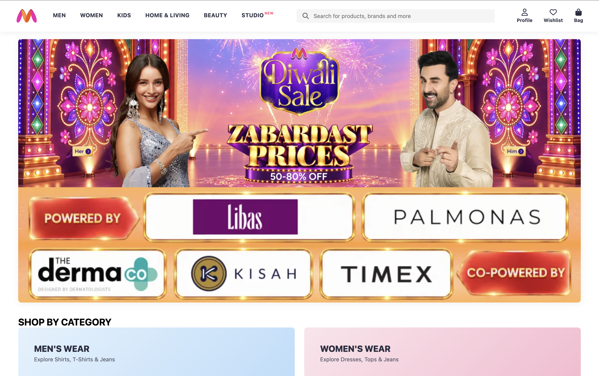
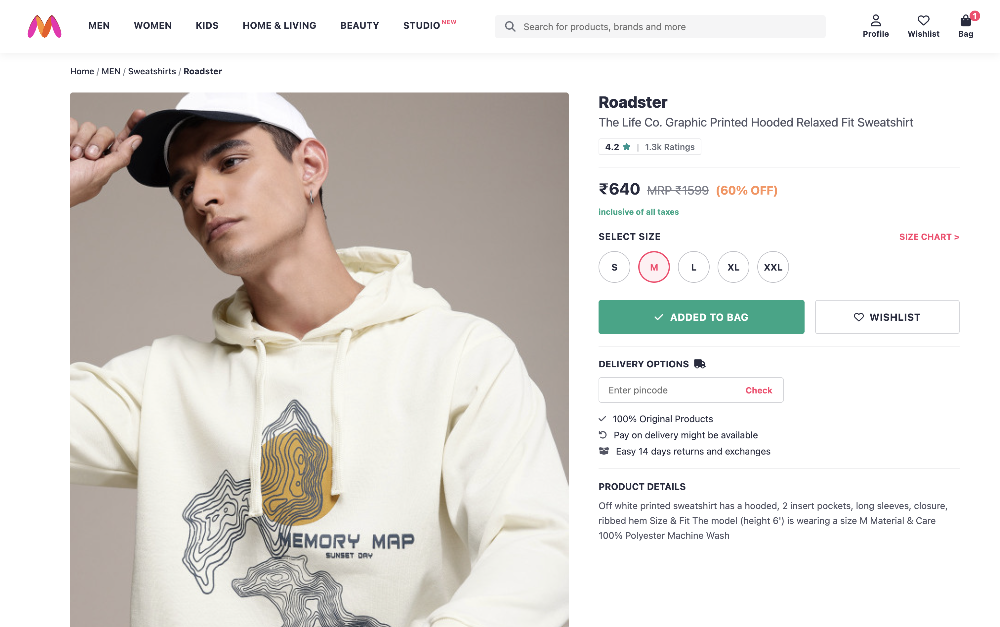
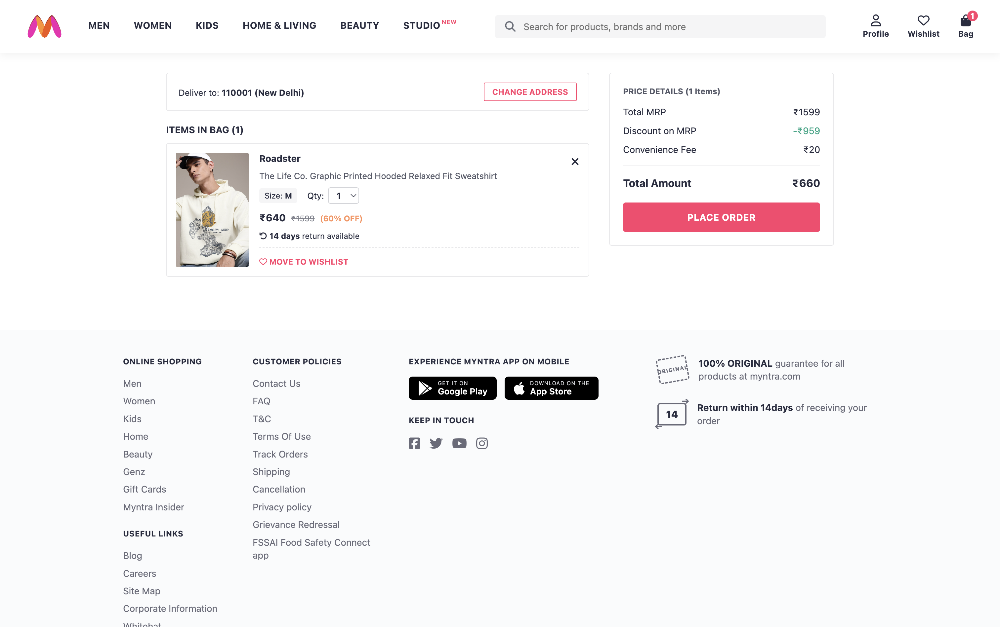
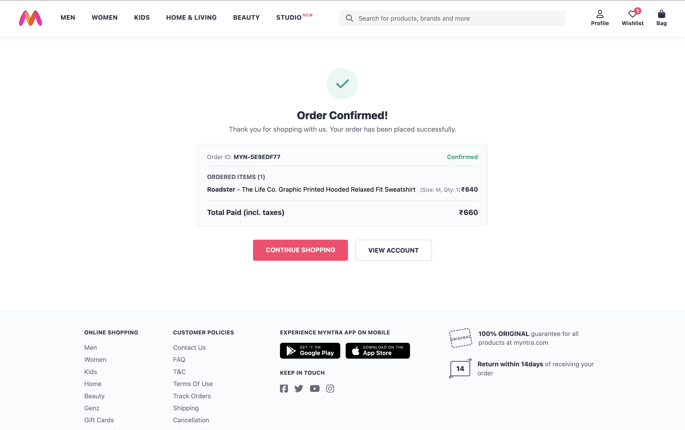
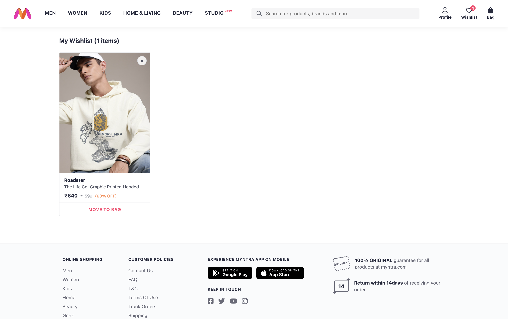
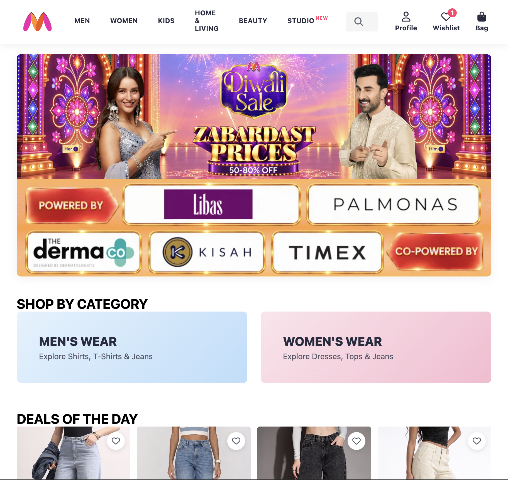

# Myntra Clone - Django Web Application Mini Project

## 1. Project Title
**Myntra E-Commerce Web Application**  
*A multi-page fashion and lifestyle storefront built with Django.*

---

## 2. Student Details
* **Course:** Django Web Application Project (Semester 3)
* **Team Members:**
  1. **Aaryan** — Roll No: `2502140002`
  2. **Nibha Singh** — Roll No: `2502140128`
  3. **Prakriti Rautela** — Roll No: `2502140057`
  4. **Sana** — Roll No: `2502140066`

---

## 3. Project Objective
The objective of this project is to develop a fully functional, responsive e-commerce web application inspired by Myntra using Django, Python, HTML5, CSS3, and JavaScript. 

The project demonstrates:
* Clean Django architecture adhering to the Model-Template-View (MTV) pattern.
* Layout reusability via template inheritance (`base.html`), ensuring consistent headers, navigation bars, and footers across all views.
* Robust dynamic URL routing and reverse resolution using the `` template tag without broken links or hard-coded paths.
* Session-based cart and wishlist state management accompanied by a custom context processor for real-time navbar counter badges.
* Secure authentication, input validation, CSRF protection, and password hashing via Django's native authentication framework.

---

## 4. Website Theme & Reference
* **Theme:** Fashion, Apparel, and Lifestyle Retail Storefront
* **Reference Platform:** [Myntra](https://www.myntra.com)
* **Design Implementation:** Recreates the visual aesthetic of Myntra, featuring brand-first typography, high-density product grids, discount badges, sticky navigation, interactive size pickers, an asynchronous Wishlist toggle, and a dedicated checkout breakdown.

---

## 5. Features and Page Descriptions

### 1. Home / Catalog Page (`/`)
* **Hero Banner:** Visual promotion section featuring dual interactive hotspots linking directly to curated Men's and Women's collections.
* **Category Mega-Menu:** Header dropdown categories covering Men, Women, Kids, Home & Living, and Beauty.
* **Catalog & Multi-Facet Filtering:** Filter products dynamically by gender, subcategory, brand, and pricing tier.
* **Search Integration:** Real-time keyword filtering across product titles and brands via GET request query parameters.
* **Product Card Grid:** Structured cards displaying product imagery, brand labels, titles, original MRP, discounted prices, ratings pills, and an instant-action Wishlist heart button.

### 2. Product Detail Page (PDP) (`/product/<id>/`)
* **Breadcrumb Navigation:** Contextual trail reflecting Home > Gender > Category > Brand.
* **Image Viewer:** Aspect-ratio locked, high-resolution product photography gallery.
* **Interactive Size Selector:** Selectable size buttons (`S`, `M`, `L`, `XL`, `XXL`) with validation preventing bag additions without a chosen size.
* **Asynchronous Actions:** AJAX-powered **ADD TO BAG** and **WISHLIST** buttons updating session data and modifying the navbar counter badges in real time without refreshing the page.
* **Delivery Checker & Info:** Pincode validation widget, original product guarantee labels, and return policy details.

### 3. Shopping Bag (`/bag/`)
* **Line Item Breakdown:** Lists added items, size specifications, brand names, and pricing.
* **Quantity Controls:** Inline dropdown selectors allowing dynamic quantity changes (1–5) with instantaneous price recalculations.
* **Move to Wishlist:** Instant action allowing users to transfer items out of the cart and into their saved wishlist.
* **Order Price Summary:** Real-time billing calculations showing Total MRP, MRP Discounts, delivery fees, and the Final Payable Amount.
* **Place Order Action:** Primary CTA initiating checkout.

### 4. Wishlist Page (`/wishlist/`)
* **Saved Items Showcase:** Dedicated responsive grid of all saved/favorited items.
* **Instant Removal (`×`):** Quick dismissal button to remove items with immediate DOM removal and navbar counter updates.
* **Move to Bag Modal:** Interactive modal allowing the user to select their desired size and transfer the product into the bag in a single click.

### 5. Order Confirmation Page (`/place-order/`)
* **Order Processing Flow:** Generates a unique tracking Order ID (`MYN-XXXXXXXX`), aggregates ordered items, flushes the active session cart, and renders an itemized confirmation receipt.

### 6. Authentication & Account Pages (`/login/`, `/signup/`, `/profile/`)
* **User Registration (`/signup/`):** Validates required credentials, email format, and password confirmation checks. Passwords are saved using Django's PBKDF2 hashing algorithm.
* **User Authentication (`/login/` & `/logout/`):** Session authentication with form validation, error messaging, and CSRF protection.
* **Profile Overview (`/profile/`):** Dedicated account dashboard with a context-aware header flyout displaying the user's name, email, and fast navigation links.

## 📸 Application Screenshots

### 🎥 Walkthrough Video
### 🎥 Walkthrough Video

[](https://drive.google.com/file/d/1hkUji4o2bcUr_30vQcrtnjReiJIRBGE3/view?usp=drive_link)

> **Note:** Click the badge above to watch the complete full-resolution video demonstration covering setup, catalog navigation, PDP interactions, wishlist/bag session management, and the checkout flow.

### 🖼️ Key Interfaces
| Home / Catalog Grid | Product Detail Page (PDP) |
| :---: | :---: |
|  |  |

| Shopping Bag | Order Confirmation |
| :---: | :---: |
|  |  |

| Wishlist Overview | Mobile Responsive View |
| :---: | :---: |
|  |  |

---

## 6. Navigation Flow Diagram

```text
                           [ Home Page ( / ) ]
                             |            |
                  (Search / Filter)  (Click Product Card / Heart)
                             |            |
                             v            v
                    [ Catalog View ]   [ Product Detail Page (PDP) ]
                                            |           |
                                 (Add to Bag)     (Wishlist Toggle)
                                            |           |
                                            v           v
                                   [ Shopping Bag ] <-------> [ Wishlist ]
                                          |            (Move to Bag / Wishlist)
                                    (Place Order)
                                          |
                                          v
                                [ Order Confirmation ]
```

* **Global Access:** The persistent header (`navbar.html`) allows navigation to `Home`, `Login`, `Sign Up`, `Wishlist`, and `Bag` from every page.
* **Form Cross-Linking:** The `Login` page links directly to `Sign Up`, and `Sign Up` links back to `Login`. Both feature a direct link to return `Home`.
* **Footer Navigation:** Consistent links across all pages for customer policies, shopping categories, and terms.

---

## 7. Technologies Used
* **Backend:** Python 3.13, Django 6.1 (MTV Architecture, Sessions, Context Processors)
* **Frontend:** HTML5, CSS3 (CSS Grid, Flexbox), Vanilla JavaScript (Fetch API, DOM Manipulation)
* **Database:** SQLite3 (Django Default ORM)
* **Icons & Fonts:** Font Awesome 6.5, System UI Font Stack (`-apple-system`, `BlinkMacSystemFont`, `Segoe UI`)

---

## 8. Django Project Structure

```text
myntra_clone/
├── manage.py
├── myntra_clone/
│   ├── __init__.py
│   ├── settings.py
│   ├── urls.py
│   ├── wsgi.py
│   └── asgi.py
├── app/
│   ├── __init__.py
│   ├── admin.py
│   ├── apps.py
│   ├── models.py
│   ├── views.py
│   ├── urls.py
│   ├── context_processors.py
│   └── migrations/
├── static/
│   ├── navbar.css
│   ├── footer.css
│   ├── home.css
│   ├── pdp.css
│   ├── bag.css
│   └── images/
└── templates/
    ├── base.html
    ├── navbar.html
    ├── home.html
    ├── product_card.html
    ├── product_detail.html
    ├── bag.html
    ├── wishlist.html
    ├── order_success.html
    ├── profile.html
    ├── login.html
    └── signup.html
```

---

## 9. How to Run the Project Locally

### Prerequisites
* Python 3.10 or higher
* Git

### Step-by-Step Installation
1. **Clone the repository:**
   ```bash
   git clone https://github.com/aaryan9907/myntra-clone.git
   cd myntra_clone
   ```

2. **Create and activate a virtual environment:**
   ```bash
   # On macOS / Linux
   python3 -m venv venv
   source venv/bin/activate

   # On Windows
   python -m venv venv
   venv\Scripts\activate
   ```

3. **Install Django:**
   ```bash
   pip install django
   ```

4. **Apply database migrations:**
   ```bash
   python manage.py migrate
   ```

5. **Create a superuser (for Django admin access):**
   ```bash
   python manage.py createsuperuser
   ```

6. **Start the development server:**
   ```bash
   python manage.py runserver
   ```

7. **Access the application:**
   Open your browser and navigate to `http://127.0.0.1:8000/`.

---

## 10. Key URL Endpoints

| Page / Feature | URL Route | HTTP Method |
| :--- | :--- | :--- |
| **Home / Catalog** | `/` | `GET` |
| **Product Details** | `/product/<int:pk>/` | `GET` |
| **Add to Bag** | `/bag/add/<int:pk>/` | `POST` |
| **Shopping Bag** | `/bag/` | `GET` |
| **Update Bag Quantity**| `/bag/update-qty/<str:cart_key>/` | `POST` |
| **Remove from Bag** | `/bag/remove/<str:cart_key>/` | `POST` |
| **Move Bag to Wishlist**| `/bag/move-to-wishlist/<str:cart_key>/` | `POST` |
| **Wishlist Page** | `/wishlist/` | `GET` |
| **Toggle Wishlist** | `/wishlist/toggle/<int:pk>/` | `POST` |
| **Move Wishlist to Bag**| `/wishlist/move-to-bag/<int:pk>/` | `POST` |
| **Place Order** | `/place-order/` | `POST` |
| **User Sign Up** | `/signup/` | `GET`, `POST` |
| **User Login** | `/login/` | `GET`, `POST` |
| **User Logout** | `/logout/` | `POST` |
| **User Profile** | `/profile/` | `GET` |

---

## 11. Known Limitations & Future Improvements
* **Payment Gateway:** The order flow currently confirms orders automatically as Cash on Delivery (COD) / Instant Demo confirmation; integration with Stripe or Razorpay can be added for live payments.
* **Persistent Cart in Database:** Active carts and wishlists are stored in Django sessions; mapping them to persistent database models would preserve guest carts across multiple browser sessions upon login.
